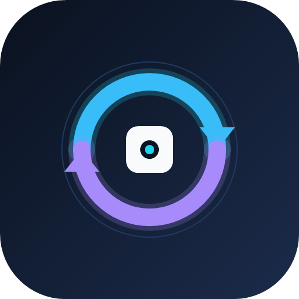

<p align="center">
  
</p>

# Jeninnet.CQRS

[](https://github.com/TarekNajem04/Jeninnet.CQRS/actions/workflows/ci.yml)
[](https://tareknajem04.github.io/Jeninnet.CQRS/)
[](https://github.com/TarekNajem04/Jeninnet.CQRS/blob/main/LICENSE)
[](https://github.com/TarekNajem04/Jeninnet.CQRS/stargazers)
[](https://www.nuget.org/packages/Jeninnet.CQRS/)
[](https://www.nuget.org/packages/Jeninnet.CQRS/)
[](https://tareknajem04.github.io/Jeninnet.CQRS/)

  

## Documentation

- [Full documentation](https://tareknajem04.github.io/Jeninnet.CQRS/)
- [API reference](https://tareknajem04.github.io/Jeninnet.CQRS/api/toc.html)
- [Release notes](https://github.com/TarekNajem04/Jeninnet.CQRS/blob/main/docs/releases/v1.0.0-preview.1.md)
- [NuGet package](https://www.nuget.org/packages/Jeninnet.CQRS/)

- **Status:** `1.0.0-preview.1` — first public preview, 2026-11-22. Pin the exact preview version.
- **Features:** 31 packable packages covering dispatch, durability, sagas, transports, contracts,
  observability, and tooling.
- **Target frameworks:** `net10.0` + `net11.0`; `netstandard2.0` for every portable package and
  `net462` for the dispatch/observability surface.
- **Release notes / roadmap:**
  [CHANGELOG](https://github.com/TarekNajem04/Jeninnet.CQRS/blob/main/CHANGELOG.md) ·
  [ROADMAP](https://github.com/TarekNajem04/Jeninnet.CQRS/blob/main/ROADMAP.md)
- **Security:** report privately through GitHub Security Advisories.

A lightweight, modular CQRS framework for .NET: commands, queries, a unified broker,
source-generated handler registration, and opt-in pipeline behaviors (logging, error
handling, metrics, validation, transactions, caching, idempotency, resilience,
notifications, diagnostics, health checks, rate limiting, JSON/Newtonsoft/MessagePack wire
formats, sagas, request/response, persistent scheduling, multi-tenancy, multi-transport
riders, AWS SQS/SNS, Azure Service Bus/Kafka/RabbitMQ/MQTT/HTTP/SignalR transports). 31 packable packages:
`net10.0` + `net11.0`, a `netstandard2.0` asset for every portable package, and `net462` for
the dispatch/observability
surface (generators/analyzers are `netstandard2.0` only); the validation, result-adapter,
FluentValidation, EF Core, and ASP.NET Core packages are framework-blocked with dated ADRs.

## Install

```powershell
dotnet add package Jeninnet.CQRS --version 1.0.0-preview.1
dotnet add package Jeninnet.CQRS.Generators --version 1.0.0-preview.1
```

Add behaviors a la carte (`Jeninnet.CQRS.Validation`, `.Caching`, `.Resilience`, `.Idempotency`, ...).

## 30-line example

```csharp
using Jeninnet.CQRS.Extensions;
using Jeninnet.CQRS.Interfaces;
using Microsoft.Extensions.DependencyInjection;

var services = new ServiceCollection();
services.AddCqrs(); // source-generated: no runtime scan
var broker = services.BuildServiceProvider().GetRequiredService<ICqrsBroker>();

var id = await broker.DispatchAsync<AddProductCommand, int>(new("Gaming Laptop", 1500m));
var product = await broker.DispatchAsync<GetProductQuery, Product?>(new(id));

public sealed record AddProductCommand(string Name, decimal Price) : ICommand<int>;
public sealed record GetProductQuery(int Id) : IQuery<Product?>;
public sealed record Product(int Id, string Name, decimal Price);

public sealed class AddProductHandler : ICommandHandler<AddProductCommand, int> {
    public Task<int> HandleAsync(AddProductCommand command, CancellationToken ct) =>
        Task.FromResult(1);
}

public sealed class GetProductHandler : IQueryHandler<GetProductQuery, Product?> {
    public Task<Product?> HandleAsync(GetProductQuery query, CancellationToken ct) =>
        Task.FromResult<Product?>(new(query.Id, "Gaming Laptop", 1500m));
}
```

## Samples

| Sample | Proves |
|---|---|
| `samples/Jeninnet.CQRS.Sample.Console` | Command + query through `AddCqrs()` with error-handling and metrics |
| `samples/Jeninnet.CQRS.Sample.WebApi` | Pipeline behind controllers, health checks, OpenAPI, SQLite idempotency |
| `samples/Jeninnet.CQRS.Sample.EndToEnd` | Validation failure, retry success, cache hit, idempotent replay — self-verified |
| `samples/Jeninnet.CQRS.Sample.AotSmoke` | NativeAOT trim proof for generated dispatch and deferred rehydration (stage → restart → replay) |

Each sample has run instructions in its own `README.md`.

## Supported frameworks

| Package group | Targets | Notes |
|---|---|---|
| Core, Caching, Idempotency, Resilience, Diagnostics, HealthChecks, Testing, Sagas | `net462`, `netstandard2.0`, `net10.0`, `net11.0` | Dispatch pipeline and in-memory stores; `net462` is a supported but frozen surface (ADR-0006). |
| `Jeninnet.CQRS.Contracts` | `netstandard2.0` | Zero-dependency message markers and metadata (ADR-0009). |
| Transports (RabbitMQ, Kafka, Azure Service Bus, AWS SQS/SNS, MQTT, HTTP) | `netstandard2.0`, `net10.0`, `net11.0` | Broker SDKs ship `netstandard2.0` legs; MQTT pins MQTTnet 4.3 for that reach (ADR-0011). |
| `Jeninnet.CQRS.Transport.SignalR` | `net10.0`, `net11.0` | Relay hub uses the ASP.NET Core shared framework (ADR-0010). |
| Serialization (MessagePack, Newtonsoft.Json) | `netstandard2.0`, `net10.0`, `net11.0` | Optional wire formats. |
| `Jeninnet.CQRS.Idempotency.EntityFrameworkCore` | `net11.0` only | EF Core 11 ships a `net11.0` leg only (ADR-0004). |
| `Jeninnet.CQRS.Sagas.EntityFrameworkCore` | `net11.0` only | EF Core 11 ships a `net11.0` leg only (ADR-0004). |
| `Jeninnet.CQRS.Validation` + three result adapters | `net10.0`, `net11.0` | Blocked by `Jeninnet.Validation.Abstractions` (ADR-0001/0002); no net462/netstandard2.0. |
| `Jeninnet.CQRS.FluentValidation` | `net10.0`, `net11.0` | FluentValidation 12 is net8-only (ADR-0003). |
| `Jeninnet.CQRS.AspNetCore` | `net10.0`, `net11.0` | ASP.NET Core shared framework has no netstandard2.0/net462 (ADR-0005). |
| `Jeninnet.CQRS.Generators` | `netstandard2.0` | Analyzer asset, runtime-agnostic by design. |
| Samples | `net11.0` (`WebApi`, `AotSmoke`), `net10.0;net11.0` (Console, EndToEnd) | Demos only, never packed. |

## Quality gates

- `dotnet test` runs the full suite; the coverage job enforces the configured line-coverage floor.
- A nightly Stryker.NET gate mutates the dispatch core, resilience wrappers, idempotency, testing
  kit, and saga dispatcher. `scripts/mutation/run-all.ps1` enforces each config's floor and writes
  `artifacts/mutation/dashboard.md`/`.json` with survivors grouped by mutator; CI uploads it.
  The measured floor table and exclusions are in `tests/Mutation/README.md`. Mutation runs are
  intentionally nightly, not per-PR.

**Quality gates:** the full build, test, format, analyzer, DocFX, AOT, package, and benchmark
gates run in CI. Release history is in
[CHANGELOG](https://github.com/TarekNajem04/Jeninnet.CQRS/blob/main/CHANGELOG.md); delivery
direction is in [ROADMAP](https://github.com/TarekNajem04/Jeninnet.CQRS/blob/main/ROADMAP.md).

Support policy: security fixes cover the current and previous major versions.